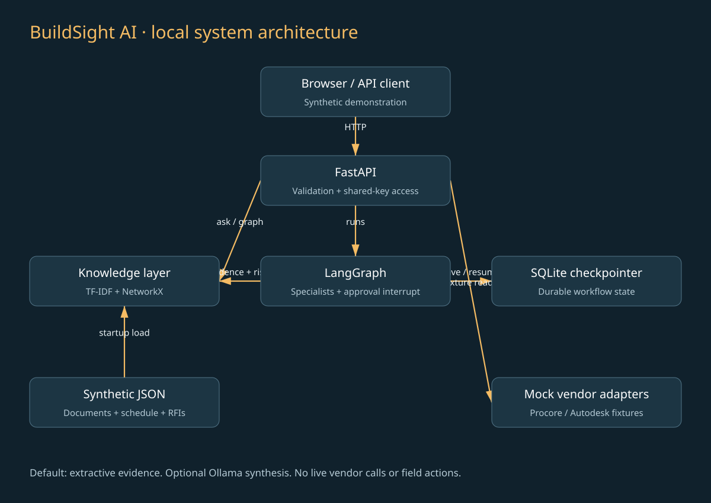

# BuildSight AI

**Construction evidence search and engineer-reviewed operations workflows.** A working personal portfolio project by Harsha Sanka, created to demonstrate applied construction AI engineering skills. Independent of Kokosing and all named vendors; no affiliation or deployment is implied.



## What you can demonstrate

Ask which unresolved RFIs may delay a bridge deck pour; inspect exact source quotations; follow `RFI-014 → ACT-030 → ACT-040 → ACT-050`; create an RFI, schedule or risk review; approve or reject the draft; restart the server and resume a pending review. All examples use fictional project BR-101.

| Capability | Implemented behavior | Boundary |
|---|---|---|
| Grounded retrieval | TF-IDF unigram/bigram ranking, cosine scores, exact source citations, no-match abstention | Default extractive baseline; optional local Ollama synthesis; no semantic embeddings |
| Agentic orchestration | Real LangGraph routing, specialist nodes, interrupt/resume | Deterministic specialists, not autonomous LLM agents |
| Human review | Persisted pending review; authenticated approve/reject; duplicate-decision rejection | Local advisory records only; no field or vendor actions |
| Knowledge graph | NetworkX typed relationships, downstream traversal | In-memory fixture graph, not a graph database or full GraphRAG |
| Schedule/risk | Open-RFI, zero-float and seven-day lookahead rules | Transparent heuristics, not trained prediction or a CPM engine |
| Procore / Autodesk | Typed connector protocol and fixture read endpoints | Simulated; no OAuth, vendor SDK, live BIM geometry or API writes |
| Operations | FastAPI, browser demo, SQLite checkpoints, tests, Docker/Compose, GitHub CI | Single-process local portfolio system, not enterprise-ready |

## Run locally

Use Python **3.13** and a terminal in the repository root. No model keys, cloud services or vendor credentials are needed. The initial lexical index is built from six short synthetic records at startup.

```bash
python3.13 -m venv .venv
source .venv/bin/activate
pip install -r requirements.lock
uvicorn app.main:app --host 127.0.0.1 --port 8000
```

Open http://127.0.0.1:8000 for the demo and http://127.0.0.1:8000/docs for API documentation. The demo key is `local-demo-key`; set `BUILDSIGHT_API_KEY` in the server environment to replace it and enter that value in the browser. The browser keeps the key only in page memory. Demo data uses **2026-11-07** as its fixed analysis date so examples remain reproducible.

```bash
curl -s http://127.0.0.1:8000/ask \
  -H 'x-api-key: local-demo-key' -H 'Content-Type: application/json' \
  -d '{"question":"Which reinforcing conflict blocks the deck pour?"}'

curl -s http://127.0.0.1:8000/runs \
  -H 'x-api-key: local-demo-key' -H 'Content-Type: application/json' \
  -d '{"kind":"schedule","question":"Which RFI blocks the deck pour?","as_of":"2026-11-07"}'
```

Copy the returned `id` into the decision path:

```bash
curl -s http://127.0.0.1:8000/runs/RUN_ID/decision \
  -H 'x-api-key: local-demo-key' -H 'Content-Type: application/json' \
  -d '{"approve":false,"reason":"Engineer disposition is still pending"}'
```

Approval never resolves the source RFI or releases construction work. It records a local review disposition in the LangGraph checkpoint.

## Optional local generative RAG

The default needs no model. To enable synthesis, install/run Ollama separately, pull a model suitable for your machine, then export its exact installed name before starting the API:

```bash
export BUILDSIGHT_OLLAMA_MODEL='YOUR_INSTALLED_MODEL_NAME'
# optional: export BUILDSIGHT_OLLAMA_URL='http://127.0.0.1:11434'
uvicorn app.main:app --host 127.0.0.1 --port 8000
```

The adapter calls Ollama `/api/chat`, requests structured claims, and verifies each cited ID and quoted span against retrieved sources. Invalid output, timeout or unavailable models fall back to excerpts. Model claim entailment is **not** automatically verified. The adapter has mocked contract tests; a live Ollama model was not available during project verification. Docker users must configure a reachable Ollama host; container localhost refers to the container itself.

## Verify

```bash
ruff check .
pytest -q
python scripts/evaluate.py
# With the API running in another terminal:
python scripts/smoke.py
```

See [verification](docs/VERIFICATION.md) for observed results and remaining validation limits. The five-query evaluation measures fixture Recall@3 and quotation integrity; it does not establish real-world accuracy.

## Docker

```bash
docker compose up --build -d
docker compose logs -f api
docker compose down
```

Compose binds only to localhost and persists SQLite in a named volume. `docker compose down -v` deletes saved reviews. The image runs as a non-root user. Set a private key before any shared deployment. CI tests the code, builds the image, starts it, and probes health; this is automated verification and packaging, not a cloud deployment.

## Repository map

```text
app/generation.py       optional local Ollama synthesis and citation checks
app/knowledge.py        retrieval, citation assembly, graph and risk rules
app/workflows.py        LangGraph specialists and human approval
app/integrations.py     mock vendor adapters and connector protocol
app/main.py             API, authentication, lifespan and persistence
app/index.html          browser demonstration
 data/project.json      fictional corpus, schedule, RFI and BIM metadata
 tests/                 API, workflow, recovery and evidence tests
 scripts/evaluate.py    hand-authored retrieval regression set
 docs/                  guides, decisions, runbooks and diagrams
```

## Documentation

- [End-to-end project guide](docs/END_TO_END_GUIDE.md): business scenario, setup, walkthrough, code explanation and demonstrations.
- [Architecture and learning guide](docs/ARCHITECTURE_AND_LEARNING_GUIDE.md): design, data flow, storage choices, tradeoffs and 30-day learning plan.
- [Technical reference](docs/TECHNICAL_REFERENCE.md): API contract, retrieval math, risk rules, workflow state and extension contracts.
- [Operations runbook](docs/RUNBOOK.md): startup, backup/restore, incidents, rollback and release process.
- [Security and limitations](docs/SECURITY.md): trust boundaries, threat model and production gaps.
- [Architecture decisions](docs/DECISIONS.md): why each major technology is present.
- [Interview and portfolio guide](docs/PORTFOLIO.md): defensible explanations and application wording.

## Scope and responsible use

This is a synthetic construction software demonstration. Do not use it to direct construction, certify safety, modify design, authorize a pour or make contractual commitments. Real deployment requires qualified construction review, identity and tenant isolation, production persistence, operational controls, evaluated retrieval and approved integrations. No proprietary CLEAR-I content, prompts, data, screenshots or results are included; its documents informed only the organization and depth of these original guides.

MIT licensed. No contribution, savings, production adoption or Kokosing endorsement is claimed.
