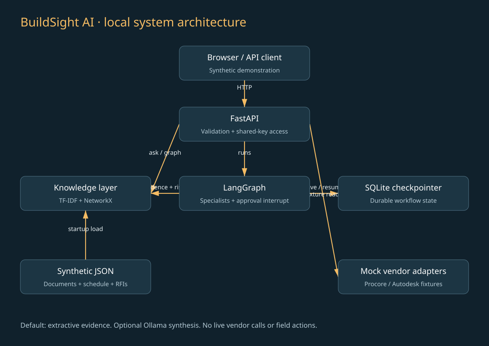
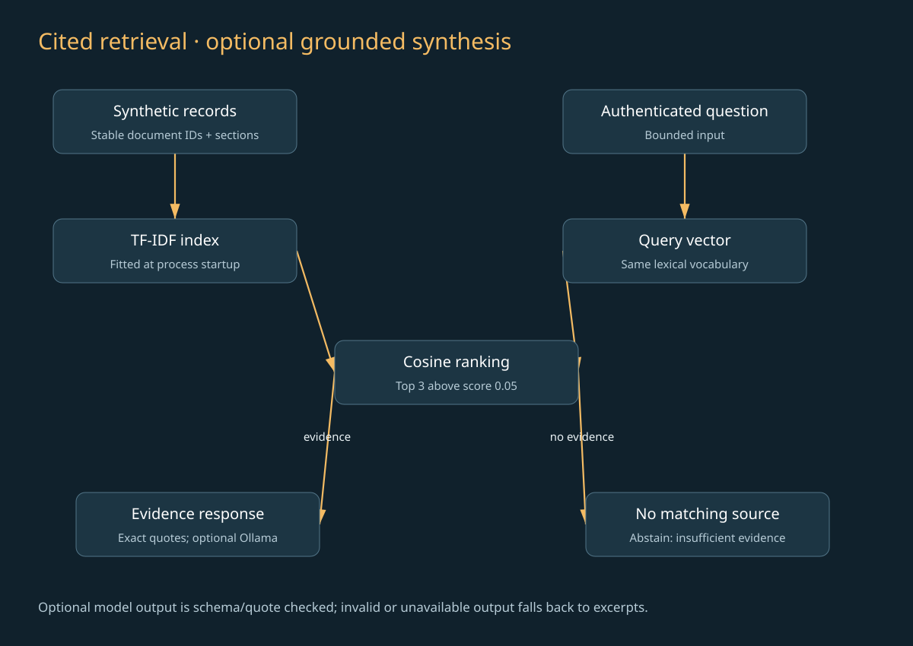
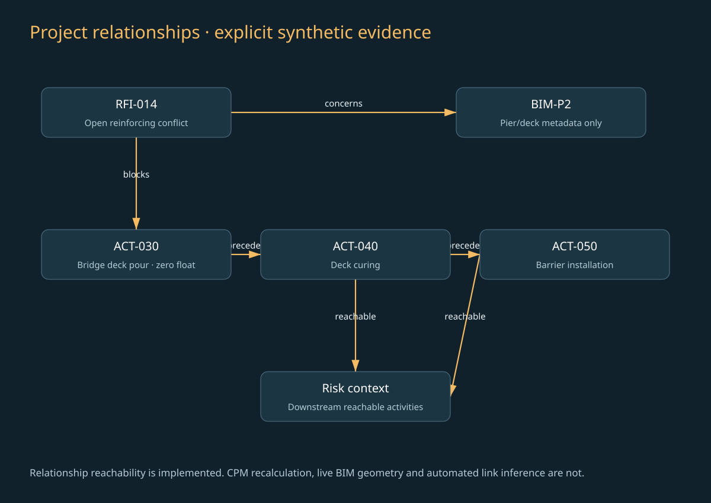
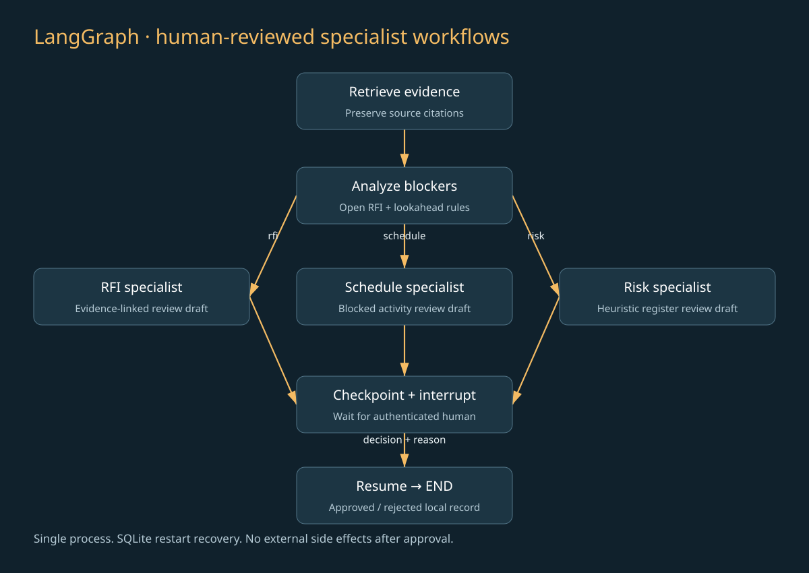

# BuildSight AI — Architecture and Learning Guide

## 1. System overview

BuildSight has four logical layers: interface, application orchestration, knowledge/analysis and storage/integration. The browser and API are real. LangGraph orchestration and persisted human review are real. The corpus and vendor/BIM records are fictional. The retrieval is a lexical baseline and response assembly is extractive. Default mode invokes no embeddings API, model or vendor API. An optional local Ollama adapter can synthesize claims with source-ID and quotation validation; live model behavior remains unverified.

## 2. Component responsibilities

| Component | Owns | Does not own |
|---|---|---|
| FastAPI | HTTP validation, shared-key check, resource lifecycle | Enterprise identity or tenant policy |
| LangGraph | Node transitions, checkpointed interrupt/resume | Reviewer identity authentication |
| TF-IDF index | Query-to-document ranking | Semantic understanding or source authority |
| NetworkX | Explicit blocker/predecessor relationships | Graph persistence or automatic link inference |
| SQLite saver | Workflow state and decisions | Immutable regulatory audit history |
| JSON snapshot | Synthetic source records | Live source-system synchronization |
| Mock connectors | Demonstration read contracts | Vendor API compatibility |

## 3. Data flow at startup

The lifespan handler opens a writable SQLite database, sets WAL journal mode, loads the fixture JSON, fits the lexical index, constructs the relationship graph and compiles workflow nodes against a SQLite checkpointer. These operations happen before requests are served. Shutdown closes the database connection.

A failed parse or missing input prevents startup, which is preferable to silently serving an empty corpus. The current fixture loader assumes the bundled schema; external ingestion requires schema validation, quarantine and revision management before loading untrusted documents.

## 4. Interactive retrieval flow

An authenticated query is validated, vectorized with the existing vocabulary and compared with the document matrix. Results below 0.05 similarity are omitted. At most three documents are returned. Citation fields are derived directly from those documents. The response includes mode and abstention flags, enabling a caller to distinguish no evidence from an answer.

This design avoids invented citations by using only excerpts. It does not solve relevance: a retrieved passage may be stale, incomplete or unhelpful. Production evaluation must separately measure retrieval, source freshness, completeness and any generated conclusions.

## 5. Relationship flow

Activities form directed predecessor edges. RFI-014 has a `blocks` edge to ACT-030 and a `concerns` edge to BIM-P2. `nx.descendants` on the blocked activity identifies ACT-040 and ACT-050. The returned path identifies the direct RFI-to-activity connection; downstream IDs show reachability, not full path explanations or computed dates.

This is graph-assisted risk analysis. The textual answer endpoint does not use graph expansion to rerank passages, so it should not be described as a fully implemented GraphRAG pipeline. A future GraphRAG version could map retrieved IDs to typed nodes, perform bounded traversals, retrieve documents for neighboring entities and return both relationship provenance and textual citations.

## 6. Workflow and approval flow

All runs begin with evidence retrieval and deterministic risk analysis. The caller selects one of three valid specialist kinds. A conditional edge routes to an RFI, schedule or risk draft node. All branches converge on the same approval node. That node calls `interrupt` with the draft and evidence. The graph saves its place under the run UUID.

The decision endpoint reads state under a lock, ensures the run is still pending, supplies a validated decision via `Command(resume=...)` and returns its final snapshot. The interrupt node runs again during resume; therefore it contains no pre-interrupt write or vendor side effect. Local approval is represented only by checkpointed state.

The implementation follows LangGraph's documented interrupt/resume contract: [interrupt reference](https://reference.langchain.com/python/langgraph/types/interrupt) and [Command reference](https://reference.langchain.com/python/langgraph/types/Command). The API test approach uses [FastAPI TestClient](https://fastapi.tiangolo.com/tutorial/testing/).

## 7. Storage choices

SQLite provides a portable, transactional checkpoint file with no separate service. NetworkX supports readable small-graph traversal. JSON makes the entire source snapshot inspectable. TF-IDF needs no remote inference or downloaded model. This combination minimizes setup and makes failure recovery demonstrable on a laptop.

Tradeoffs matter. Large corpora require incremental indexing and filters. Large shared graphs require graph storage or relational adjacency queries. Concurrent deployments require a production checkpoint backend, migrations, access policies and per-run coordination. A graph database should be selected based on query shape and scale, not added just to list another technology.

## 8. Retrieval concepts

TF-IDF gives greater weight to words that distinguish a document from the rest of the corpus. Bigrams retain phrases such as “mix design.” Cosine similarity compares normalized vector direction. Scores are lexical similarities rather than confidence or calibrated probabilities. Out-of-vocabulary words contribute nothing.

Semantic embeddings would map language into learned representations and may improve synonym recall, at the cost of model choice, dependencies, evaluation and potentially external data transfer. Hybrid retrieval could combine lexical exact IDs with semantic similarity. Neither change should be assumed better until measured on construction questions with expert relevance judgments.

The current source record is the chunk unit. Real specifications and RFIs need section-aware chunks, revision IDs, page numbers, stable content hashes and permissions. Mixing revisions can yield a perfectly quoted but obsolete answer.

## 9. Schedule and risk concepts

The heuristic joins an open RFI to its affected activity. If the planned start is within seven days or already past and float is zero, severity is high; otherwise it is medium. It separately marks overdue RFIs using the analysis date. It traverses downstream dependencies for impact context.

This is not critical path recomputation. It does not propagate durations, calculate calendars, account for weather, quantify schedule confidence or learn from historical outcomes. Real schedule analytics would need validated precedence types, lags, calendars, resource constraints and reconciliation with the scheduling system.

## 10. Security and trust boundaries

The public page and health check do not expose project records. Other endpoints require the shared key. Pydantic restricts input length and accepted workflow values. The UI writes results as text instead of interpreting source HTML. Authentication checks use constant-time comparison. The container is non-root and Compose exposes only loopback.

These are local safeguards, not enterprise security. One key maps all users to `local-reviewer`; there is no tenant isolation, granular authorization, SSO, rate limiting, immutable audit trail or encryption-at-rest configuration. Database files contain question/evidence/decision data and require host access controls. See the security document for extension priorities.

## 11. Observability and operation

Uvicorn provides request and process logs. The health endpoint confirms process availability; it does not verify a live vendor connection or prove field-readiness. Tests are the primary behavior checks. Checkpoint history can aid debugging but is not an immutable event ledger. Do not log production document bodies or credentials.

If a run seems stuck, inspect its state and distinguish a pending human interrupt from a failure. If restart loses state, first verify the database path and volume. If SQLite is locked, verify that only one server process owns the local workload. Detailed procedures are in the runbook.

## 12. Batch versus online work

Corpus preparation and graph construction currently happen at startup. Retrieval and workflows happen online. There is no background queue or scheduled ingestion service. A larger design should build versioned indexes offline, validate them, atomically select an approved snapshot and expose its version in each response. That avoids inconsistent evidence during an index rebuild.

## 13. Future production architecture

A potential design would add an identity provider, API gateway, queue, approved source adapters, object storage for immutable snapshots, search service, relational application store and production checkpoint backend. External actions should use an outbox and idempotency keys. Approval should bind an authenticated reviewer to a precise draft/evidence version. This is a roadmap rather than a deployed architecture.

## 14. Thirty-day learning plan

| Days | Focus | Concrete evidence of learning |
|---|---|---|
| 1–3 | Run locally; understand RFI/submittal/schedule terms | Demonstrate one grounded answer and trace each citation |
| 4–6 | Read the synthetic data and knowledge module | Draw the blocker chain and explain graph direction |
| 7–9 | TF-IDF, cosine similarity and abstention | Add five synonym/hard-negative queries and inspect misses |
| 10–12 | FastAPI validation and shared-key boundary | Explain 401, 404, 409 and 422 responses |
| 13–15 | LangGraph nodes, state and routing | Demonstrate all three branches and explain templates |
| 16–18 | Interrupts, checkpoints and recovery | Stop/restart a pending run and reject it afterward |
| 19–21 | Test design and evaluation limits | Distinguish quote integrity, recall and real-world utility |
| 22–24 | Docker and CI | Run the image where Docker is available and inspect CI logs |
| 25–27 | Connector design and security | Propose a sandbox adapter and least-privilege scopes |
| 28–30 | Stakeholder demonstration and portfolio | Record a five-minute demo and document measured limits |

## 15. Learning questions

Why can an exact quote still produce a poor answer? Because source fidelity and query relevance are different. Why is an approval not an RFI resolution? Because the system records a local advisory decision and has no authority to change engineering records. Why persist checkpoints? So interruption survives process lifetime. Why avoid vendor calls in this demo? Because access and real action semantics are not established. Why retain a baseline? Because it provides an inexpensive, reproducible comparison for later model changes.

## 16. Glossary

**RAG:** retrieval-augmented generation; this project defaults to an extractive baseline and includes optional local Ollama synthesis with quote/source validation. **Graph-assisted analysis:** structured relationship traversal used alongside document evidence. **Idempotency:** repeated requests do not duplicate a business side effect; duplicate terminal decisions are rejected here, while generalized request idempotency remains future work. **WAL:** SQLite write-ahead logging. **CPM:** critical path method, not implemented here. **Provenance:** the origin and version of a record or relationship. **HITL:** human in the loop.
